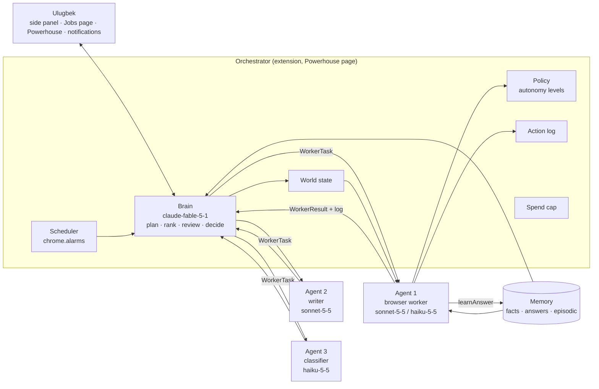

# Sidekick architecture

Updated 2026-11-10 for the v1 "Powerhouse" plan (`PLAN.md`). §1 is what runs today (v0.9.6), §2 what's wrong with it, §3 the v1 design and the reasons for each choice, §4 the decisions log.

## 1. How it works today (v0.9.6)

### Runtime contexts (Chrome MV3)

| Context | Files | What runs there |
|---|---|---|
| Service worker | `src/background/background.ts` → `dist/background.js` | Opens the side panel on toolbar click; context menus; first-install onboarding. Nothing long-lived. |
| Side panel page | `src/pages/sidepanel.html` → `src/ui/sidepanel/` | All runtime logic: chat, model calls, math pipeline, the browser agent, memory, learning, the benchmark and job-batch runners. Dies when the panel closes. |
| Injected into web pages | `src/page/*` via `chrome.scripting.executeScript({ func })` | Snapshots of interactive elements (all frames), actions (click, type, select, pick_date, upload), page text, area picking. Self-contained functions (ADR-005). |
| Content script, MAIN world | `src/content/webmcp-capture.js` | Captures tools a site registers with `navigator.modelContext` (WebMCP). Inert elsewhere. |
| Debugger (CDP) | `src/core/browser/cdp.ts` | Real mouse/keyboard input, screenshots, clipped zoom captures. 4 s timeout per command. |
| Other pages | `profile`, `options`, `evals`, `runs`, `bench`, `jobs`, `mic` | Editors and dashboards; each a separate page with its own module. |

ES modules, bundled by Vite into `dist/` (ADR-002); one typed storage schema (`src/core/storage/schema.ts`); every read-modify-write under a Web Lock (`core/storage/update.ts`).

### Modules

| Folder | What's there |
|---|---|
| `core/llm` | `settings` (defaults, model IDs, provider), `call` (`modelCall` with the stall watchdog, `watchModelCalls` for traces), Claude Messages and OpenAI Responses streaming, `usage` (tokens per model per day), `prices` (dollars) |
| `core/security` | `guard` (redaction, `untrusted()` fence, injection scan, `stripWrappers`), `sites` (`siteOf`: Public Suffix List + shared hosts), `personal-data` |
| `core/browser`, `core/web`, `core/docs`, `core/calc` | captures and page reads with time limits, `TrustedInput`; `read_url` (SSRF-guarded, redirects checked per hop) and keyless search; PDF/DOCX text; calculator |
| `core/storage` | `schema.ts` (every key and type, `readLocal`), `update.ts` (`updateLocal`, `withStorageLock`) |
| `assistant` | `turn` (one chat turn), `routing`, `prompt`, `tools`, `review/` (math double-check), `memory/` (memories, documents, BM25 recall, import/export), `skills`, `session` (pinned notes, learning from each message and from answers to the agent, end-of-chat reflection), `profile-core` |
| `agent` | `loop/run` (the loop, budgets, nudges), `loop/plan`, `loop/tab-group`, `perception/` (full or change-only snapshots), `actions/` (`run-tool`: every tool and gate; `input`, `describe`, `replay`), `safety/gates`, `skills/` (shortcuts, site notes), `trace/` (run recorder and store), `tools`, `prompt` |
| `jobs` | `sources` (job-board APIs), `sponsors` (UK register, USCIS H-1B), `eligibility` (rules in code), `store` (job list, batch picking, CSV), `scan`, `cover` (student-voice letters checked in code), `pdf`, `batch` (judging a run), `seed` |
| `bench` | the ten-task real-site benchmark |
| `page` | injected functions, checked by `scripts/check-build.mjs` |
| `ui` | `sidepanel/` (entry + state, `agent-card`, `bench-run`, `jobs-run`, `chats`, `messages`, `notify`), `profile/`, `options/`, `evals/`, `runs/`, `bench/`, `jobs/`, `shared/` |

### Main flows

**Chat turn:** `send()` → `runTurn()` builds the system prompt and the context block (date, tab, pinned notes, relevant memories, skills) → model with chat tools (calculate, read_url, read_page, remember/recall, use_skill, operate_browser) → math double-check when routed → reply rendered as sanitized Markdown → pinned notes refreshed and lasting facts saved (one fast call).

**Agent run:** `sendAgent()` → `runAgentCard()` → `runAgent(goal, ui, opts)`: snapshot (all frames; a full view, then only changes) → model (smart tier, or fast for batches) → `runTool` with its gates (never-act sites → site re-check → personal-data check → final-action approval → CAPTCHA refusal) → plan/checklist → learn a shortcut and notes at the end. The trace records every step, call and approval as it goes.

**Application batch:** Jobs page `Build` → `Approve & start` writes `jobBatch` (session storage) → `jobs-run` opens its own window and, per queued job: cover letter → PDF → `sendAgent` with `tier: "fast"`, `files`, `preApproved` → `judgeRun(trace)` → applied / needs_you / skipped → 2–4 min pause.

### Storage (`chrome.storage.local`)

Settings fields, `profile`, `applications`, `memories`, `docIndex` + `doc:<id>`, `skills`, `userModel`, `adapters`, `siteNotes`, `chatIndex` + `chat:<id>`, `usage`, `evalRuns`, `traceIndex` + `trace:<id>` + `traceShot:<id>:<n>`, `benchRuns`, `benchParams`, `benchMaxCost`, `jobs`, `jobCompanies`, `sponsorLists`, `jobSettings`. Session: `pending`, `benchPending`, `jobBatch`, `jobBatchStop`.

### Tests

jsdom suites (685 checks), Vitest unit tests (46), real Chromium with the built extension (87 checks). `npm run check` runs all of it.

## 2. What's wrong with it

1. **No brain.** Every feature is a separate runner in the side panel (`bench-run`, `jobs-run`, chat); nothing plans across them, nothing knows the whole state (BUGS 4).
2. **Nothing runs when the panel is closed.** The agent and the batch live in the side panel page (BUGS: "overnight").
3. **Memory is free text, retrieved by keyword against the wrong query** (BUGS 1): no structured facts, no answer bank, no question matching.
4. **Autonomy is a pile of gates** in `run-tool.ts` and `gates.ts`; "pre-approved" covers some of them (BUGS 3).
5. **Model strings live in `DEFAULT_SETTINGS` and tier names in callers**; no per-role assignment.
6. **Perception** is home-grown (CSS heuristics); real sites still cost many steps (ADR-003 stays open; v1 keeps the current perception and spends on reliability through policy, memory and retries).
7. **No spend cap**, only a per-run limit for batches and benchmarks.

## 3. v1 target architecture

### 3.1 The brain and the workers



- **Brain** (`src/orchestrator/brain.ts`): a handful of typed calls, never a loop: `rankBatch(candidates, world)`, `reviewRun(trace summary)`, `triageNeedsYou(items)`, `rankAssignments()`, `answerUser(question, world)`. Each gets the compact world summary (stable prefix, cached) and returns typed JSON (structured outputs). Model: `models.brain`.
- **Workers** (`src/orchestrator/workers.ts`): `WorkerTask { id, n, kind: "apply" | "read" | "write" | "classify", model, goal, context: WorldSlice, memory: MemorySlice, files?, policy: AutonomyLevel, resumeFrom? }` → `WorkerResult { status, output, log, cost, traceId?, needsYou? }`. Kinds map to engines: `apply`/`read` → `runAgent` (the existing loop, taking the task), `write`/`classify` → one model call with a schema. Numbered 1..n as they start; the Powerhouse shows them.
- **Model config** (`src/core/llm/models.ts`): `MODELS = { brain, browser, browserCheap, writer, classifier, tieBreak }` per provider, with max tokens and effort per role; `DEFAULT_SETTINGS` keeps provider and keys only. A lint rule (`no-restricted-syntax` on `/claude-|gpt-/` string literals outside `models.ts`/`prices.ts`) keeps strings out of code.
- **World state** (`src/orchestrator/world.ts`): `WorldState { jobs: { queued, applying, applied(30d), needsYou }, assignments, reminders, workers, spend: { today, month, caps }, lastBatchAt, now }` built from storage on demand, plus `summarize(world)` (≤2K tokens) for prompts and `slice(world, kind)` per worker. Workers also get a `world_query` tool answered from storage (no model).
- **Policy** (`src/orchestrator/policy.ts`): `AutonomyLevel = "ask-final" | "approved-batch" | "read-only" | "every-click"`; `allowed(action, ctx): "run" | "ask" | "needs-you" | "refuse"` is the single function every gate calls. `approved-batch` runs submits, Enter-submits, uploads and typing on the job's ATS site, the company's site and any frame host of the form; refuses payments/deleting/posting; sends CAPTCHA, login, SSN/ID/bank fields and unsure legal attestations to Needs You; `read-only` (school) refuses every final action.
- **Scheduler** (`src/orchestrator/scheduler.ts`): named `chrome.alarms` (`batch-8am`, `apply:<jobId>`, `remind:<id>`, `watchdog`), all created from storage so a Chrome restart recreates them; application times drawn uniformly over the next 20 h with a 15-min minimum gap and one company per day.
- **Action log** (`src/orchestrator/log.ts`): `{ at, worker, kind: submit|send|trash|upload|visit, what, why, undo? }` in `actionLog` storage, shown on the Powerhouse and the Jobs page; email trash entries carry the undo.
- **Spend cap** (`src/core/llm/budget.ts`): `modelCall` asks `budget.allow(cost estimate)` first; over the daily or monthly cap it throws `SpendCapError`; workers catch it at step boundaries and finish at a safe point; the orchestrator sets `paused: "spend-cap"`.

### 3.2 Where it runs: extension-hosted orchestrator, daemon later if needed (ADR-011)

Evaluated:

| | (a) Extension only | (b) Local daemon (Node, launchd) + extension as hands |
|---|---|---|
| Runs while Chrome is open and the Mac is awake | yes, if an extension page stays open: the Powerhouse page hosts the loop; `chrome.alarms` wake the service worker to reopen it if closed | yes; the daemon also runs with Chrome closed, but only API work (email, ranking, scans): applications need Chrome anyway |
| Survives Chrome quit | alarms persist and fire on the next launch; state is in storage | daemon keeps going; the browser part waits |
| Mac asleep | nothing runs in either; `OVERNIGHT.md` keeps it awake |
| Secure token storage | WebCrypto non-extractable AES key in IndexedDB; tokens encrypted at rest in `chrome.storage` (protects against reading the storage file, not against code running in this Chrome profile) | macOS Keychain through the daemon: the real thing |
| Install and moving parts | none new | a native-messaging host manifest, a launchd plist, a Node runtime, an update path |
| Path to Electron + Swift | the orchestrator is pure TS with a `Host` interface (`alarms`, `storage`, `notify`, `browser`); Electron implements the same interface | same core; the daemon *is* an early Electron main process |

Decision: **(a) now**, with the orchestrator written against a `Host` interface so it can move. The trigger for (b) is concrete: when Phase 8 needs tokens the extension cannot protect well enough for him, or when email work should run with Chrome closed. Recommended, not decided: the brief leaves this to him (PLAN decision 3).

How (a) stays alive: the Powerhouse page is opened as a pinned tab in its own window by the service worker on startup (`chrome.runtime.onStartup`) and by the `watchdog` alarm every minute if it is missing; the page runs the orchestrator tick (what is due, what is running, what to dispatch); the service worker only owns alarms and the panel. If the page is closed on purpose (Pause), the alarm does not reopen it until Resume.

### 3.3 Memory (ADR-012)

```mermaid
flowchart TB
  Q[ask_user question] --> F{fact store<br/>field match}
  F -- hit --> A[answer, log "from memory"]
  F -- miss --> K{answer bank<br/>BM25 prefilter → Haiku "same question?"}
  K -- hit --> A
  K -- miss --> N[notify, wait, Needs You card]
  N -->|Save & resume| LEARN[learnAnswer: question, normalized key, answer, type, options]
  A --> LEARN
  LEARN --> BANK[(answers)]
  CHAT[messages, reflections] --> EP[(episodic memories<br/>BM25 + optional embeddings)]
  EP --> BRAIN[brain context]
  FACTS[(facts<br/>typed, versioned)] --> BRAIN
  FACTS --> WORKER[worker context]
  BANK --> WORKER
```

- **Facts** (`src/memory/facts.ts`): `Record<FactKey, { value: string; updatedAt: number; source: "profile" | "resume" | "chat" | "application" | "you" }>`; keys are an enum (`fullName`, `email`, `phone`, `address.*`, `school`, `degree`, `major`, `gradMonth`, `highSchool`, `highSchoolYear`, `citizenship`, `visaStatus`, `workAuthorizedUS`, `needsSponsorship`, `eeo.*`, `salary`, `relocation`, `startDate`, `links.*`, …). The profile page edits them; the old `profile` object migrates on first run and stays as a view.
- **Answer bank** (`src/memory/answers.ts`): `{ id, question, normalized, answer, fieldType: text|select|radio|checkbox|file|date, options?, site, askedAt: number[], updatedAt }`. `normalize()` lowercases, strips punctuation and stop words, maps synonyms (secondary school → high school, grad → graduation). `findAnswer(q, opts)`: BM25 over normalized questions → top 3 → one Haiku call "do these ask the same thing? which option matches?" → threshold → the answer (or an option from the form's list). Every hit and miss is logged in the trace.
- **Episodic** (`src/memory/episodic.ts`): today's `memories` with `recall(query)` by BM25; an `embedding` field filled by OpenAI `text-embedding-3-small` when that key exists (hybrid 70/30 as OpenClaw), else BM25 only. Anthropic has no embeddings API; this stays optional.
- **Storage:** local (`chrome.storage.local`, the existing locked writes); IndexedDB only if the bank outgrows a few MB. Supabase + pgvector rejected for v1: it moves his most personal data off the machine for a multi-device benefit he doesn't need yet (PLAN decision 4).
- **Memory page** (`memory.html`): facts, answers, episodic, export/import.

### 3.4 Data flow of one day

```mermaid
sequenceDiagram
  participant S as Scheduler (alarms)
  participant B as Brain (Fable)
  participant W as World state
  participant A as Agent n (browser worker)
  participant M as Memory
  participant U as Ulugbek
  S->>W: 08:00 ET: eligible jobs with sponsorship evidence
  B->>W: rankBatch(candidates, summary) → 15–20 jobs
  B-->>U: notification: today's batch is ready
  U->>W: Approve
  S->>S: random times over 20 h, one per company
  loop each scheduled job
    S->>A: WorkerTask(apply, policy approved-batch, memory slice)
    A->>M: findAnswer(question) on every ask
    alt answered
      A->>A: fill, continue
    else not answered
      A-->>U: notification, wait N min
      A->>W: Needs You card (questions, types, options)
    end
    A->>W: applied + answers + confirmation screenshot
    A->>B: result; brain reviews only failures
  end
  U->>W: Save & resume (answers → M) → new WorkerTask(resumeFrom)
```

### 3.5 Security

- Keys and OAuth tokens: encrypted at rest with a non-extractable WebCrypto AES-GCM key (IndexedDB) and stored in `chrome.storage.local` as ciphertext; the Settings page shows only "set". Limits stated in SECURITY.md; Keychain only with the daemon.
- All page, frame, email and job-posting text stays inside `untrusted()`; the brain never receives raw page text, only worker summaries; an email or page that carries instructions for the agent is flagged in the log and the Powerhouse.
- Irreversible actions (submit, send, trash, upload) go through `policy.allowed()` and the action log; nothing leaves the machine except model-provider and connected-service calls.
- Honesty in code: work-authorization and sponsorship answers come only from the fact store; the trace records the source of every typed value; a value with no source fails the run's review.

### 3.6 Storage additions (v1)

`facts`, `answers`, `actionLog`, `assignments`, `reminders`, `emailAccounts` (ciphertext), `emailLog`, `orchestrator` (`{ paused, lastTick, workers, scheduled }`), `jobSettings` grows (`batchSize`, `batchTime`, `countries`, `needsYouWaitMinutes`, `onePerCompanyDays`), `spendCaps`, `notifications`. Every key typed in `schema.ts`; every read-modify-write under the lock.

## 4. Decisions (docs/adr/)

- ADR-001 (open): build vs. fork the agent core; the benchmark decides. v1 keeps the current core.
- ADR-002: Vite with a hand-written manifest. ADR-004: vanilla TS DOM code. ADR-005–008: page scripts, test bundles, fixed key, strictness. ADR-009: run traces. ADR-010: the job pipeline (company boards, government sponsor lists, approval per batch, human pace).
- ADR-011 (proposed, §3.2): extension-hosted orchestrator behind a `Host` interface; daemon when tokens or Chrome-closed work require it.
- ADR-012 (proposed, §3.3): memory as a typed fact store + answer bank + episodic list, local storage, BM25 + Haiku matching, embeddings optional.
